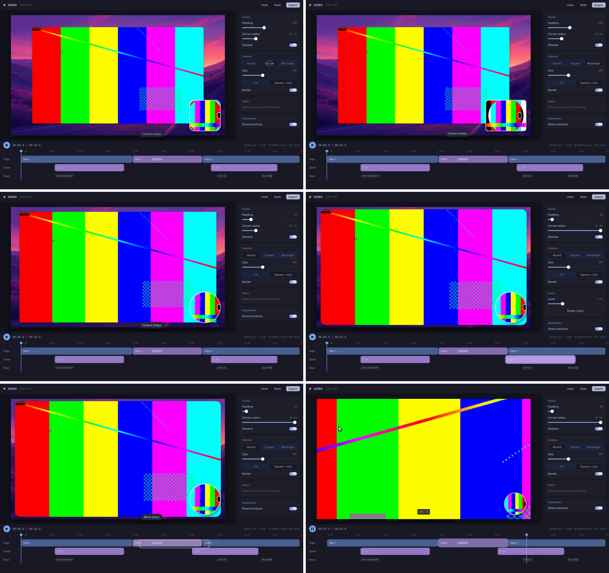

# Rune spike: report

> **The whole app has since been ported.** `RESULTS-full-port.md` measures the full port against
> Qt on foundry2 (2026-11-08) and replaces the foundry2 numbers below; `report.html` is the
> shareable summary. This report covers the first spike: the preview, the export, the bar and a
> slice of the editor.

omareel's preview, offscreen export and recording bar built with **Rune** (anomalyco/rune,
`dev` at `8ee3095`, 2026-11-06) over `omareel_core`, plus a slice of the editor (inspector and
timeline) to see where the interface could go. Measured against the Qt build of this branch on
foundry2 (Intel Iris Xe, Raptor Lake-P, 20 threads; Mesa, Qt 6.11, **Hyprland 0.57.0**).

Rune is two weeks old (first commit 2026-10-22), pre-release, MIT, and asks apps to pin a `dev`
rev. It is a wgpu/winit toolkit with its own renderer, text, layout and springs, written for
SwiftUI-like motion and for being driven headless by agents.

**In short:** everything in `../SPEC.md` works with no fork and no patch: the preview, an
offscreen export that needs no display, and an interactive layer-shell recording bar, all from
built-in API. The export is **1.07× Qt's speed from a 1080p bundle** (113.1 against 105.6
frames/s) and 0.94× from a 4K one, with frames that match Qt's (SSIM 0.992). The preview holds
60 frames/s at 1080p and 4K with **the same pacing as Qt** (p95 17.0 against 16.9 ms), its UI
thread spends **under 1 ms a frame** at 1080p, the lowest of any toolkit tried, and it is the
first spike that decodes video in hardware (VA-API through ffmpeg, NV12 into Rune's video
surface). The cost is on the GPU: Rune redraws and blends every quad every frame, so the preview
keeps the Xe's render engine **45 % busy against Qt Quick's 7.5 %**. Rune's motion and headless
tooling made the editor slice the most convincing UI any spike produced, but Rune is two weeks
old, pre-release, and changes daily.

## What was built

| Part | Files | Lines | Qt counterpart (lines) |
|---|---|---|---|
| Composition | `src/comp.rs` (project → `Settings`, the view, experiments) | 557 | Composition, RoundedFrame, CursorOverlay, CameraOverlay, BlurredBackdrop, KeystrokeOverlay, Background QML (686) |
| Preview | `src/preview.rs`, `src/video.rs` | 891 | PreviewPane.qml (295) + QtMultimedia playback |
| Offscreen export | `src/export.rs` (with its GPU-timing diagnostics) | 352 | Exporter.cpp + ExportRenderer |
| Recording bar | `src/bar.rs` | 90 | RecordingBar.qml (412, many more features) + LayerShellQt |
| Editor slice | `src/editor.rs`, `src/theme.rs` | 686 | TopBar, SidePanel and its panels, Timeline, ClipTrack, ZoomTrack and controls (3,047), which do far more |
| Setup, CLI, helpers | `src/setup.rs` (from the Slint spike), `src/main.rs`, `src/bin/spike-pointer.rs` | 251 | (spike only) |
| Measurement | `scripts/` (ported from the Slint spike to Hyprland 0.57's Lua `hyprctl eval`) | 372 | |

- **Logic**: everything comes from `omareel_core`, as in the other spikes: `Document`
  (`preview_composition` per frame) for the preview and editor, `ExportJob` (decode, per-frame
  `CompositionState`, encoder with `omareel export`'s arguments) for the export. The spike only
  draws.
- **Composition** (`comp.rs`): one view function, `composition(settings, media, frame, w, h)`,
  that rebuilds the tree each frame from omareel_core's state; Rune diffs it. Wallpaper (cover),
  the frame with padding, rounded corners, border and shadow, the zoom (`.scale().origin()`), the
  cursor SVG (rasterised by Rune's `ImageCache`), click ripples, the camera bubble (round, border,
  45° shadow, presence scale, shrinking while zoomed) morphing into the full-frame square over a
  **GPU-blurred** copy of the camera (`.blur(σ)`), keystroke pills in fontconfig's monospace.
  Everything QML does in this scene had a built-in: no custom shader, no CPU blur.
- **Preview**: a winit window; Rune's `poll` hook runs each frame, takes the clock, picks the
  decoded frames and asks for the next frame. Video goes through `rune::NativeSurface`: ffmpeg
  hands over **NV12** (no RGB conversion on the CPU, 1.5 bytes a pixel) and Rune converts in its
  video shader. With `--decode vaapi` (the default where omareel's export would use VA-API) ffmpeg
  decodes on the GPU's video engine and copies NV12 back, so the CPU only moves bytes. This is the
  first spike where the preview decodes in hardware; it took no interop, only ffmpeg's flags.
  `--upload pixels --decode software` is the other spikes' path (RGBA from omareel_core's decoder
  into `rune::Pixels`), kept for comparison.
- **Export**: Rune's headless path is public API. A `Runtime` builds each frame from the same
  view; a `Renderer` on our own wgpu device draws it into a texture; three readbacks in flight
  feed `ExportJob::encode`. No platform, no window, no display: it runs over ssh.
  Decoded frames go through `rune::Pixels` (RGBA, as the export's decoder makes them).
- **Bar**: `App::overlay` with `interactive: true` is a wlr-layer-shell surface on the overlay
  layer, built in. `hyprctl layers`: `xywh 850 12 220 52, namespace omareel-recording-bar`.
  Stop, clicked through `spike-pointer` (wlr-virtual-pointer) in the nested compositor, quit the
  app. Pulsing dot (`LoopSpec`), live clock (`LiveText`, no view rebuild).
- **Editor slice** (`editor` subcommand): see "Improving the UI" below.

Play, Pause and the scrub bar were clicked in the nested compositor (`scripts/interact.sh`):
play started, pause held, the scrub landed at 6.2 s on the full-frame camera.

## What Rune needed, and what it got wrong

Nothing was forked or patched. `Cargo.toml` pins the `dev` rev, as Rune asks.

1. **`Color` is linear light.** `Color { r, g, b, a }` takes linear sRGB; Qt colours are encoded.
   Passing `QColor::red() / 255` made every theme colour too light (the keystroke pill came out
   grey: 36.0 dB against Qt instead of matching), with no warning: `rune::color::srgb_decode` is
   the fix. The type doesn't say which encoding it holds; a field name or constructor
   (`Color::srgb`) would have caught it.
2. **Overdraw is the app's job.** Rune blends every quad and has no opaque pass or occlusion
   culling, so a black fill under the video, a theme colour under the wallpaper and the root fill
   under everything each cost a full quad (about 0.5 ms each at 1080p on the Xe). Dropping the
   hidden fills took the export's GPU pass from 4.45 to 3.51 ms. Qt Quick's scene graph does this
   itself (opaque items front to back with depth testing).
3. **A box shadow on a filled box is cheaper than on an empty one** (Rune cuts the interior when
   the box is opaque) but every frame redraws every shadow; an analytic Gaussian over a large
   frame is the most expensive primitive in this scene after the video.
4. **`clip_rounded(0.0)` is not a free rectangle clip**: use `clip_soft(0.0)`.
5. **`Tx::quit()` from an overlay's press handler is ignored**: the overlay host only reads
   shell requests on focus changes (`overlay/any_host.rs`). The bar quits through
   `App::handle().quit()` instead. Worth an issue upstream.
6. **The README is behind the code**: it says interactive overlays are unavailable on Wayland;
   pointer input on layer surfaces is wired and works.
7. **`NativeSurface` on Linux takes bytes only** (`push_bytes`, BGRA or NV12) and uploads them
   with `queue.write_texture` on the UI thread; the zero-copy path is macOS (IOSurface). A VA-API
   dma-buf import would be the Linux equivalent; until then hardware decoding means a copy back.
8. **`Player` (video playback) is macOS-only**; on Linux it reports `Failed`. The spike decodes
   with ffmpeg itself, as every spike did.
9. **No display link off macOS**: `wake_after(0)` asks for the next frame and Mesa's FIFO
   present paces it. In practice that held 60 frames/s as steadily as Qt (see the numbers).
10. **Rust 2024 and Rune's `dev` move fast**: two weeks old, ~1,560 commits, a 285 KB changelog.
    Pinning a rev is mandatory, and an upgrade is a re-test.

## Numbers

All on foundry2, each run started once the machine had been under 8 % CPU for 6 s
(`scripts/quiet.py`), all with the final binary. Raw results were in
`~/.cache/omareel-spikes/rune-bench/results2`;
`scripts/summary.py <dir>` prints these tables. Median of 3 runs (range); the software variants
are one run each.

### Preview (SPEC 5)

In the nested Hyprland 0.57 (`tests/tools/nested-hyprland.sh`) on a 1920x1080@60 headless output
(`scripts/in-nested.sh`), both apps auto-playing the bundle; the canvas is 1102x620 in both.
Frame times are the intervals between the window's `wl_surface.commit`s (`WAYLAND_DEBUG=client`,
`scripts/frames.py`, 9.5 s of playback, counted from the spike's "measured playback starts" line
so its paused window before playback is left out). CPU, RSS and GPU (DRM fdinfo engine busy time) come from
`scripts/sample.py` over 8 s. "Decoder CPU" is the spike's ffmpeg children. Qt decodes in-process
on the video engine (its "GPU video" column); the spike's VA-API decoding also runs on the video
engine, but in the ffmpeg child, which the sampler does not read, so its column shows 0.
"Dropped" is each app's own count: Rune's is recording frames never shown, Qt's is
`OMAREEL_PREVIEW_STATS`'s `drops`. "UI-thread frame" is Rune's poll to the end of encoding
(`App::on_frame_encoded`).

| | frames/s | frame ms p95 | max | missed vsyncs (>25 ms) | dropped | CPU % | decoder CPU % | RSS MB | GPU render % | GPU video % | UI-thread frame ms |
|---|---|---|---|---|---|---|---|---|---|---|---|
| **Rune** 1080p (VA-API, NV12 surface) | 59.6 (59.5–59.7) | 17.0 | 29.6 (21.8–29.9) | 1 | 5 (3–5) | 12.8 | 19.5 | 226 | **44.8** | (in ffmpeg) | **0.78** |
| **Qt** 1080p | 59.5 (59.4–59.8) | 16.9 | 17.6 (17.5–33.4) | 0 | 1 (1–11) | 15.1 | – | 332 | **7.5** | 25.4 | – |
| Rune 1080p (software, NV12 surface) | 59.5 | 17.1 | 29.9 | 1 | 4 | 13.8 | 33.5 | 226 | 47.0 | – | 0.89 |
| Rune 1080p (software, RGBA `Pixels`) | 59.5 | 17.8 | 31.9 | 3 | 6 | 31.0 | 52.4 | 274 | 50.0 | – | 2.74 |
| **Rune** 4K (VA-API, NV12 surface) | 59.5 (59.4–59.6) | 17.4 | 29.1 (28.1–29.4) | 2 | 4 | 38.0 | 68.8 | 298 | **31.0** | (in ffmpeg) | 3.15 |
| **Qt** 4K | 59.7 (59.6–59.8) | 17.0 | 30.4 (28.5–39.8) | 5 (3–9) | 69 (61–75) | 20.8 | – | 529 | **6.0** | 74.0 | – |
| Rune 4K (software, NV12 surface) | 57.4 | 18.3 | 33.7 | 23 | 25 | 41.6 | 129.1 | 277 | 45.7 | – | 3.12 |
| Rune 4K (software, RGBA `Pixels`) | **36.1** | 36.8 | 49.8 | 221 | 240 | 127.6 | 239.6 | 438 | 39.5 | – | 13.9 |

- **CPU on the UI thread is tiny.** Rebuilding the whole composition from omareel_core's state
  and diffing it costs about 0.8 ms a frame at 1080p; at 4K the 12 MB NV12 upload brings it to
  3.2 ms. (Slint's femtovg took 7.5 ms for the same scene.) RSS is the lowest of the windowed
  toolkits after iced, and well under Qt's.
- **Hardware decoding without interop.** NV12 halves what crosses the pipe and skips the RGB
  conversion; VA-API then cuts the decoders from 34 % to 20 % of a core at 1080p and from 129 %
  to 69 % at 4K, and is what holds 4K at a steady 60 (software decoding misses 23 vsyncs). The
  RGBA path the other spikes used collapses at 4K here (36 frames/s): 33 MB a frame through
  `Pixels` on the UI thread. Qt still wins on CPU at 4K: it never copies frames off
  the GPU.
- **GPU: 6× Qt Quick.** Rune's renderer is one instanced uber-shader that blends every quad,
  every frame, with no opaque pass, no occlusion and no partial redraw. On the Xe a full-frame
  opaque quad costs about 0.5 ms (measured with `--gpu-timing` on the export: 1, 2, 4, 8 fills =
  0.54, 1.00, 1.94, 3.81 ms), an image or video quad about 0.9 ms per 1600x900, a large analytic
  shadow similar. The window chrome alone (no composition) is 8 % busy. (The 4K run shows a lower
  percentage than 1080p, most likely the GPU clocking up under the heavier upload load.)
- **Pacing matches Qt.** A first round of measurements showed Rune at 56 frames/s with 13–25
  missed vsyncs; every long gap was in the 1.5 s before playback, while the paused window still
  committed a frame every 30–50 ms and `frames.py` folded that into the run. Measured from the
  start of playback, Rune commits every vsync as Qt does. (Ruled out on the way: the surfaces'
  waker, and Mesa's FIFO against mailbox present.)

### Export (SPEC 6)

The 600-frame bundle to 1920x1080 MP4 at 60 fps, quality "social" (the same `ExportJob`, so the
same ffmpeg arguments; master now encodes with `h264_vaapi` here, so these are not comparable to
the earlier spikes' libx264 numbers). Wall time of the whole command, both with a display.

| | seconds | frames/s |
|---|---|---|
| **Rune**, 1080p bundle | 5.30 (5.29–5.32) | **113.1** |
| Qt `omareel export`, 1080p bundle | 5.68 (5.67–5.72) | 105.6 |
| **Rune**, 4K bundle | 11.12 (11.01–11.21) | 54.0 |
| Qt `omareel export`, 4K bundle | 10.48 (10.37–10.51) | **57.3** |
| Qt without `WAYLAND_DISPLAY` (software renderer), 1080p | 13.97 | 43.3 |

- Per frame at 1080p (`--timing`): pixels hand-over 0.16 ms, view and layout 1.35, prepare,
  encode and submit 5.65, readback 1.9. The GPU pass itself is 3.5 ms median (8.9 ms p95, the
  camera-blur frames) with `--gpu-timing`.
- At 4K the 33 MB RGBA frame upload on the render thread (`Pixels` uses `write_texture`) is what
  loses to Qt; NV12 from the decoder, as the preview does, would quarter it, but `ExportJob`'s
  decoder makes RGBA.
- **Rune's export needs no display.** Qt's export uses its GPU path only when a Wayland or X
  display is set; over ssh or in CI it falls back to the software renderer at 43 frames/s.
- Frames against Qt's: PSNR 36.3 dB, SSIM 0.9925 over the encodes; the screen sections are at
  43–45 dB per frame. The 150 frames under 35 dB are the camera clip, where Qt blurs a 24x24
  capture of the camera and Rune applies a real Gaussian (64 px): the same look, different pixels
  (`images/export-morph-qt-vs-rune.png`: Qt top, Rune bottom).

### Launch and responsiveness

`scripts/launch.py`, in the nested Hyprland on the 1920x1080@60 headless output, 6 launches of
each app opening a copy of the 1080p bundle (the first, least warm, reported apart). Times come
from the app's own Wayland log (its first committed buffer, the button events it received) and
from quarter-size `grim` screenshots of the middle of the preview every 15–25 ms, which bounds the
resolution of the screenshot-timed rows. Seeks and Play are clicked through `spike-pointer`, both
apps at the same points in the recording (seek to 2.0 s, then 7.7 s; Play from 2.0 s).

| | Qt `omareel edit` | Rune `editor` | Rune `preview` |
|---|---|---|---|
| Launch to first frame on screen | 0.58 s (first 0.59) | **0.24 s** (0.24) | 0.23 s (0.24) |
| Launch to the video showing | 0.73 s (first 0.74) | **0.35 s** (0.33) | 0.34 s (0.34) |
| Click to the next frame (any visible answer) | 1.1 ms | 0.5 ms | 0.5 ms |
| Play to motion, median (range) | 91 ms (87–107) | 97 ms (34–135) | 117 ms (37–162) |
| Seek on the timeline to its frame, median (max) | **14 ms** (20) | 92 ms (118) | 95 ms (114) |
| Idle, paused: CPU % / GPU render % / commits a second | 0 / 0 / 0 | 0.6 / 0 / 0 | 0.6 / 0 / 0 |
| Idle RSS, app / with its decoders (MB) | 310 / 310 | **201** / 502 | 199 / 504 |

- **Rune opens in less than half Qt's time**: a window in 0.24 s against 0.58, the video in
  0.35 s against 0.73. Qt loads its QML, the editor's full interface (wallpaper grid, timeline
  thumbnails) and fades in over 160 ms; the Rune slice draws less, so part of the gap is scope,
  and the first frame alone is 0.24 s against 0.58: a gap a user feels on every open.
- **Both answer a click within a frame**, and neither draws anything while paused: Rune's "an idle
  window draws nothing" holds (0 commits a second).
- **Play** is a tie once the spike reuses the paused decoder (it used to start ffmpeg again on
  every Play: 260–460 ms). Rune's spread is wider; Qt's pipeline adds a steady ~5 frames.
- **Seeking is where Qt wins, 14 ms against 92**, and it is the spike's video design, not Rune:
  every seek starts a new ffmpeg process (omareel_core's decoder is the ffmpeg CLI on a pipe),
  which opens the file and decodes from the last keyframe. Qt seeks inside its in-process
  decoder. A Rune omareel would need in-process decoding (libav through `ffmpeg-next`, or
  GStreamer) with a decoder kept open, the same piece that would give it zero-copy frames.
- **Memory while paused**: the Rune app itself is a third smaller than Qt's, but its paused ffmpeg
  decoders hold another 300 MB (frames decoded ahead, for an instant Play). Stopping them after a
  few idle seconds would trade that for a cold Play (~150–300 ms); in-process decoding would make
  the trade unnecessary.

### Diagnostics left in

`--timing` (export stages), `--gpu-timing` (a timestamp query around each export frame's pass;
with `--png <frames>` it also prints those frames' instances and layer targets),
`SPIKE_EXPERIMENT=noblur,noshadow,noclip,nocamera,nokeys,nobg` (parts of the scene taken away;
in the preview also `nocomp`, `novideo`, `nocanvasshadow`, `nocanvasclip`, `nowaker`),
`SPIKE_VIEW=fill<n>|video|cursor|stage|clip` (the export draws a test scene to price a
primitive) and `SPIKE_DEBUG=1` (poll and pill logging). `scripts/launch.py` measures launch and
responsiveness (see above); its usage is in its header. The GPU findings above come from them.

### Build and size

- Clean release build 2 min 19 s with rune-kit (20 threads). A one-line change: 31 s in
  release (with Rune's `incremental = true, codegen-units = 16`; 48 s without), **1.5 s in debug**.
  Iterate in debug.
- Binary: 237 MB with line tables, **34 MB stripped**, statically linking Rune, wgpu, Parley,
  resvg and the image decoders; 6 shared libraries, no Qt. (The Qt `omareel` is 17 MB plus 17 Qt
  libraries.)

## Improving the UI

The `editor` subcommand is a slice of omareel's editor in Rune: top bar, the preview, an
inspector (Frame, Camera, Zoom, Keystrokes) and a timeline (clips, zooms, shortcut keys), all
over the real `Document` (`set_project_value`, `move_zoom`, `set_zoom_level`, `remove_zoom`,
`split_at_playhead`, `undo`/`redo`), themed from the current Omarchy theme. It never saves.

What it does that the QML editor doesn't, and what each cost:

- **Edits spring.** Paused, picking a camera shape morphs the bubble round → square → rectangle on
  a spring; dragging padding or corner radius glides the frame. The composition is a plain view,
  so this is one line: the composition's `instant_changes()` applies only while playing. In QML
  each property would need its own `Behavior`, and the export path would have to turn them off.
  A click on a slider's track springs the knob (and the preview) there; drags then follow the
  pointer at once.
- **The timeline moves physically.** A zoom block lifts (scale and shadow on springs) while
  dragged and settles when dropped; the selection ring is one element `matched` across tracks, so
  it flies from a zoom to a clip; the playhead glides on seeks and lands at once while playing;
  edits announce themselves in a toast that slides in and fades.
- **Keyboard**: Space plays, S splits at the playhead, ⌫ deletes the selected zoom, ⌘Z/⌘⇧Z
  undo and redo (the Document's history).
- **It can be checked without a compositor.** The same binary renders headless, with real video
  frames (the decoders are waited on, the clock is virtual):

  ```sh
  B=target/release/omareel-rune-spike
  $B editor ~/spike/b1080 -- --snap editor.png --at 2
  $B editor ~/spike/b1080 -- --script scripts/editor/demo.json --video editor.mp4 --keys --pointer
  $B editor ~/spike/b1080 -- --tree tree.json        # every element: key, rect, text, opacity
  ```

  `scripts/editor/demo.json` taps the camera shapes, drags two sliders, drags a zoom, selects a
  clip, seeks and plays; the video is the demo, and the tree is what a test asserts on. Today
  omareel's UI checks need a nested Hyprland, `grim`, and `QT_QPA_PLATFORM=offscreen` workarounds
  (and the offscreen screenshot never shows the preview). For code that agents write, this is the
  largest single gain on offer: an agent can see and test what it changed.


Six frames of the scripted demo (`--script scripts/editor/demo.json --video`): the camera
mid-morph from round to square; rectangle; padding dragged down; corner radius up, a zoom
selected (the inspector shows its level); the selection ring in flight from the moved zoom to a
clip; playing.



The recording bar on the nested compositor's overlay layer:


What it would take to go further: the timeline's trimming and range selection (1,400 lines of
QML drag logic), the export dialog, file and colour dialogs (rune has file dialogs; no colour
picker), tooltips (rune-kit has them), the launcher and countdown windows. rune-kit covers
buttons, switches, segmented controls, selects, menus, popovers, toasts and lists; there is no
slider, so the spike has its own (40 lines).

## Writing it (agent ergonomics)

- **Views are plain Rust.** No markup, no bindings: `el().size(w, h).radius(r).fill(c)` and
  ordinary `if`/`for`. Loops and helpers that QML keeps in JavaScript are just Rust, and every
  property is type-checked. The composition ported formula for formula.
- **Compile errors were few and clear**: six on the first build (field names on `Drag`, a
  variable name), all pointed at by rustc.
- **What got past the compiler**: linear vs encoded colour (a visual diff against Qt's export
  found it), overdraw (found by GPU timestamps), `Tx::quit` in an overlay, my own poll that
  stopped asking for frames (Rune draws nothing when nothing asks, by design), and a measurement
  artifact that looked like bad pacing (found by plotting the commit gaps).
- **The docs are long and specific** (the core README is 2,800 lines, written for agents:
  "start from examples/hello and check your work headlessly"), and largely accurate; where they
  ran out, the source is readable. `--snap`, `--tree` and GPU timestamp queries made every visual
  and performance question answerable without a display.

## Running it on n1x (aarch64, NVIDIA)

Rune needs a recent stable Rust (edition 2024); the Rune spike builds with 1.99.

```sh
cd spikes/rune
cargo build --release                      # about 1.5 min on foundry2
bash ../make-bundle.sh ~/spike/b1080 1080
bash ../make-bundle.sh ~/spike/b2160 2160
B=target/release/omareel-rune-spike
$B setup ~/spike/b1080; $B setup ~/spike/b2160
$B preview ~/spike/b1080                   # Space, scrub bar
$B preview ~/spike/b2160 --decode software --measure 10 --stats 4k.json
$B editor ~/spike/b1080                    # the editor slice
$B export ~/spike/b1080 -o rune.mp4 --quality social --timing [--gpu-timing]
omareel export ~/spike/b1080 -o qt.mp4 --quality social --timing   # needs WAYLAND_DISPLAY for Qt's GPU path
$B bar                                     # the pill at the top; Stop exits
```

- wgpu uses the NVIDIA GPU through Vulkan. `--decode vaapi` is never chosen there: omareel's
  rule skips NVIDIA's VA-API driver (it crashes on n1x), so the preview decodes in software;
  `--decode-height 1080` has ffmpeg scale a 4K screen down if 4K drops frames.
- `scripts/measure.sh` reproduces the tables in a nested Hyprland (Hyprland 0.57's Lua config;
  needs `grim`, Python 3 and the Qt build's path).

## Verdict for omareel

**Not now; watch it.** Rune is the most interesting toolkit the spikes have tried, and the one
whose strengths line up with how omareel is written:

- **What it is better at than Qt Quick here:** launch (the editor's video on screen in 0.35 s
  against 0.73), the UI thread (under 1 ms a frame at 1080p) with the same 60 frames/s pacing,
  memory, an export
  that runs without a display and is faster at 1080p, layer-shell and offscreen rendering built
  in, views in plain type-checked Rust, and above all **headless rendering, scripted input,
  video recording and element trees of the real app**: what omareel's agents need to check their
  own UI work, and what today takes a nested Hyprland and still can't screenshot the preview.
  The editor slice's motion (springing edits, a flying selection, a lifting drag) came almost for
  free.
- **What keeps it from replacing Qt Quick today:**
  1. **GPU cost**: 6× Qt's render-engine time for the same preview, structurally (no opaque pass
     or partial redraw). On a laptop that is battery.
  2. **Video on Linux** is bytes through the CPU: Rune's zero-copy video import exists only on
     macOS, so 4K still costs about a core where Qt decodes into GPU memory, and the spike's
     ffmpeg-per-seek decoding makes seeks 92 ms against Qt's 14. In-process decoding is the
     fix for both, and it is omareel's to write whichever toolkit it uses.
  3. **Maturity**: two weeks old, pre-release, `dev`-only, ~100 commits a day, bugs like
     `Tx::quit` in overlays and a README behind its code. Built for Mac first (players,
     recorders, pacing, present timestamps are macOS-only).

All three are Rune's to fix, and its maintainers take issues ("have your agent open an issue").
Worth filing, in order: an opaque pass or damage tracking for the uber renderer, dma-buf/VA-API
import for `NativeSurface` on Linux, and `Tx::quit` from overlay handlers.

**Against the other spikes** (their numbers in `../REPORT.md`, measured on Hyprland 0.56 with a
libx264 export, so only the shape compares): Rune's UI-thread cost beats Slint's (7.5 ms) and
GPUI's; its GPU cost is like Slint's (36–41 %) and above iced's (23 %); it alone decodes in
hardware and exports headless without a custom platform. If omareel ever leaves Qt, Rune now
competes with Slint for the place: Slint for stability and a QML-like markup, Rune for motion,
agent tooling and plain-Rust views. Re-run this spike in a few months against a newer `dev`:
the code is ready (`scripts/measure.sh`).

**Worth taking now, whatever the UI:** NV12 + VA-API through ffmpeg for any wgpu renderer
(it needs no interop), and the idea of the editor slice's headless `--script`/`--video` checks
for omareel's own UI tests.
